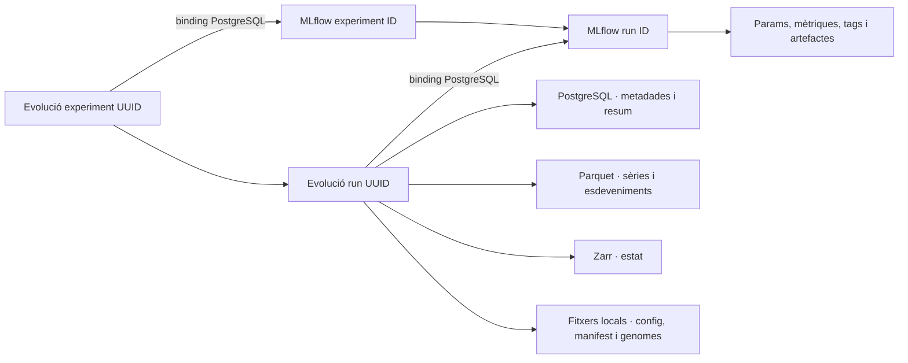

# Seguiment experimental amb MLflow

MLflow ofereix una vista reconstruïble dels paràmetres, les mètriques i els artefactes de cada execució. El registre conserva dos identificadors. El UUID d'Evolució identifica l'execució científica i MLflow assigna el seu identificador quan crea el registre remot. PostgreSQL desa la correspondència entre tots dos. Cada experiment d'Evolució té un experiment MLflow i cada simulació d'un batch hi té una execució pròpia.

| Dada | Font |
| --- | --- |
| Experiment, execució, metadades i resum relacional | PostgreSQL |
| Configuració congelada | `config.json` i snapshot PostgreSQL |
| Sèries, naixements, morts, genealogia i resums analítics | Parquet |
| Checkpoints i snapshots | Zarr |
| Manifest, índexs i genomes destacats | Fitxers locals i registre de genomes |
| Vista de seguiment i comparació | MLflow |



## Configuració i CLI

Instal·la l'extra amb `uv sync --group dev --extra persistence` i aplica la migració `0003_mlflow_tracking_bindings` amb `uv run alembic upgrade head`. Configura `EVOLUCIO_DATABASE_URL` per al registre d'Evolució i `MLFLOW_TRACKING_URI` per al servidor de tracking. En producció, els clients es connecten per HTTP(S) a un MLflow Tracking Server desplegat independentment, amb el seu backend i el seu magatzem d'artefactes. Es pot compartir el servidor PostgreSQL amb una base o un esquema separat per a MLflow. Les credencials i la URI de tracking són configuració d'infraestructura i queden fora de la configuració científica i de la projecció.

```console
evolucio mlflow status
evolucio run config.json --steps 100 --experiment-id EXPERIMENT_UUID --mlflow
evolucio mlflow sync runs/RUN_UUID
evolucio mlflow verify runs/RUN_UUID
```

`run` i `batch run` accepten `--mlflow`, `--no-mlflow`, `--mlflow-metrics-interval N` i `--mlflow-required/--mlflow-optional`. El seguiment s'activa explícitament i requereix un experiment PostgreSQL. Quan està activat, és obligatori per defecte. `--dry-run` només mostra la política. `status` llegeix el catàleg d'experiments per comprovar la connexió.

## Projecció

- Els tags `evolucio.run_id`, `evolucio.experiment_id`, `evolucio.config_hash` i `evolucio.mode` permeten filtrar i identificar les execucions. Quan estan disponibles, s'afegeixen cas, ordinal del batch, commit i versió del paquet. Els runs fallits inclouen el tipus d'error i, si es coneix, el pas.
- Els params inclouen llavor, passos totals, mida de chunk, població inicial i màxima i els camps escalars de món, població, energia, evolució, política i observacions. La configuració congelada completa es conserva a `metadata/config.json`.
- La sèrie inclou `population.alive`, `population.births`, `population.deaths`, `energy.total_alive`, `resources.total`, `lineages.active`, `genetics.parameter_variance` i `environment.mean`. El mostreig conserva els punts amb `step % metrics_interval == 0`, amb el pas absolut original independentment del chunk.
- Les mètriques `final.*` recullen població viva, naixements, morts, llinatges actius, energia i recursos finals i, quan existeixen, nombres de files dels resums d'agents i llinatges. Els benchmarks registren `runtime.elapsed_seconds` i `runtime.steps_per_second` a partir del seu resum local.
- `metadata/` conté la configuració, el manifest terminal, el resum o l'error i `tracking.json`. `indexes/` conté els índexs Parquet, Zarr i de genomes disponibles. `genomes/` conté els NPZ referenciats per l'índex de genomes destacats. Els índexs remeten als datasets Parquet i als estats Zarr del run local.

## Fallades, sincronització i verificació

PostgreSQL i el manifest conserven l'estat científic. La binding MLflow i `artifacts/mlflow/tracking.json` registren l'estat tècnic `active`, `degraded`, `failed` o `synced`. El fitxer de tracking és mutable i s'escriu atòmicament com a fitxer lateral. La finalització publica primer els artefactes locals i el registre PostgreSQL, sincronitza la projecció i acaba l'execució MLflow amb `FINISHED` o `FAILED`.

Si la inicialització de tracking obligatori falla, la simulació no s'inicialitza i el registre científic conserva l'estat `created`. Una fallada durant el registre de mètriques permet que continuï la simulació i deixa que la sincronització final en recuperi els punts des de Parquet. Si falla la sincronització terminal obligatòria, el CLI retorna error i la simulació pot quedar completada. Amb `--mlflow-optional`, el CLI informa d'un problema de tracking i conserva el codi de sortida científic. Quan falla la simulació, el seu error continua sent el principal.

`sync` reconstrueix execucions terminals a partir del manifest, la configuració congelada, PostgreSQL, el resum, l'índex i les parts Parquet i els artefactes seleccionats. Reutilitza la binding existent o cerca el UUID remot quan la binding falta. Afegeix els punts absents i reutilitza els artefactes que ja consten amb el mateix hash. Una segona sincronització manté els mateixos IDs i la mateixa història. Els conflictes d'identitat, params immutables o valors de mètriques requereixen resoldre la discrepància abans de continuar. En una migració de servidor, conserva la base de tracking i els IDs per reutilitzar les bindings existents.

`verify` és una operació de lectura que compara bindings, estat, tags, paràmetres, història de mètriques i artefactes. Retorna 0 si coincideixen, 1 si hi ha discrepàncies i 2 davant d'un error d'entrada o connexió. La projecció es limita al tracking explícit, amb índexs per a les dades de gran volum.
